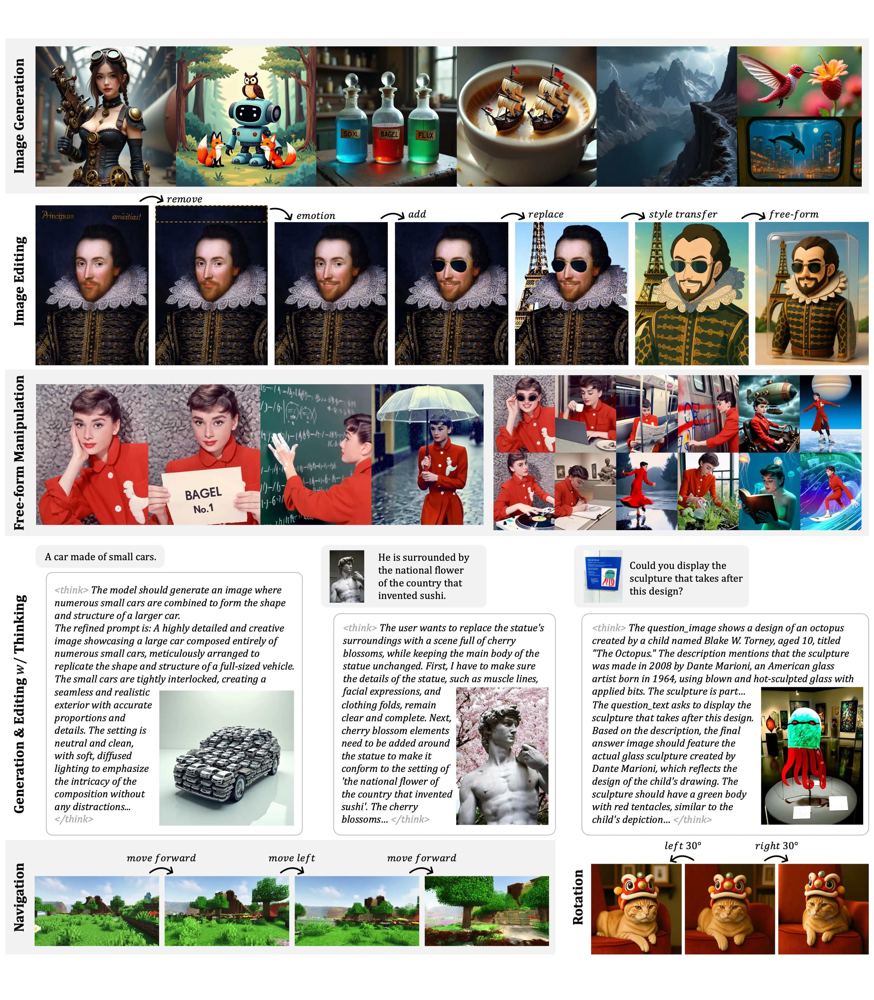
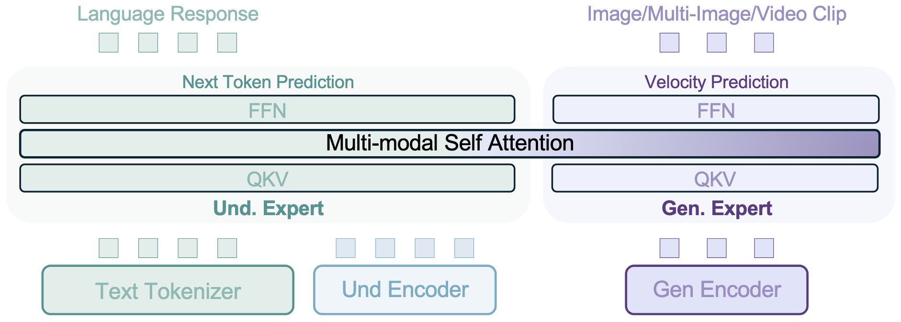
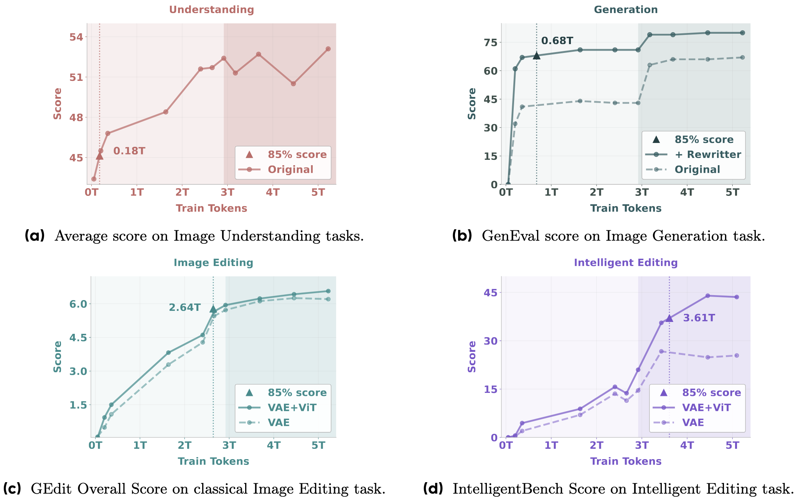

# Faster-BAGEL

[English](README.md) | [简体中文](README.zh-CN.md)

**1.82× faster BAGEL-7B-MoT supervised fine-tuning steps on 8 Hopper GPUs, optimized by AI agents.**


| Implementation | Time / training step (s) ↓ | Speedup ↑ |
|---|---:|---:|
| Reference | 1.4367 | 1.00× |
| **Faster-BAGEL** | **0.7873** | **1.82×** |

Measured with a full check on **8 Hopper GPUs (80 GB)**: supervised fine-tuning of the released BAGEL-7B-MoT checkpoint (14.61B parameters) with the official recipe. That means FSDP `HYBRID_SHARD` 1×8, FP32 parameters, FP32 AdamW state and FP32 EMA, BF16 compute, about 4,096 packed tokens per GPU, and **no FP8**. The timer runs the repository's real training loop. Reference, candidate and reference run in independent processes on the same host with fresh compile caches. The candidate then passed the check's numerical gates by **statistical equivalence**; it is not bitwise identical. The exact ratio is **1.8249×**. The goal was 3×; it was not reached.

In the 2,000-step validation runs, each start-to-exit time includes initialization and checkpoint saves. Faster-BAGEL took **2,110–2,209 s** against **3,517–3,726 s** for the reference, about **0.73–0.76 s vs 1.46–1.53 s** per steady step. These runs were on different hosts, so the numbers are descriptive, not a paired benchmark. Memory rises: peak 60.05 / 73.36 GiB allocated / reserved per GPU in the full check, against 41.16 / 57.89 GiB for the reference.

## Quick Start

Prepare the [environment and public data](docs/training.md), including the 900/100 VLM split, and set absolute paths. The optimizations are environment switches on the upstream trainer. The launcher enables the M6 set and runs the official SFT recipe on 8 GPUs:

```bash
export MODEL_PATH=/path/to/BAGEL-7B-MoT
export BAGEL_DATA_ROOT=/path/to/bagel_example
export BAGEL_TRAIN_JSONL=/path/to/train.jsonl
export BAGEL_EDIT_META=/path/to/edit_meta.json
export OUTPUT_DIR=/path/to/results
export CHECKPOINT_DIR=/path/to/local/checkpoints
export CACHE_DIR=/path/to/local/fresh-cache
export GPU_LOCK=/path/to/shared-gpu.lock
bash scripts/train_faster_bagel_sft.sh
```

Equivalently, `source scripts/configs/faster.env` and run the upstream `torchrun ... train/pretrain_unified_navit.py` command with the [recorded arguments](docs/training.md#launch-and-baseline-corrections). `REFERENCE=1` clears the switches. Tested only with **PyTorch 2.7.1 + CUDA 12.6 (Triton 3.3.1) and flash-attn 2.7.4.post1** on 8 GPUs. Every switch is off by default; with none set, the code takes the upstream path plus two computation-preserving corrections (serial checkpoint loading and extra metric logging).

## Agent Optimization History

Each point is a full check on the same host, 8 Hopper GPUs, by the same frozen judge.


## What changed

- **Memory and recomputation:** upstream recomputes every checkpointed layer in the backward pass while the GPUs use about half of their memory.
  - The LM, the SigLIP encoder and the connector now keep their activations instead of recomputing them.
  - To make that fit, only cheap but large activations are recomputed: RMSNorm copies, the SwiGLU product, and the MLP part inside compiled layers.
- **Mixture-of-transformers layers:** the residual stream stays ordered by expert, so the understanding and generation experts read contiguous slices instead of gathering and scattering tokens in every sub-module. RMSNorm, SwiGLU and rotary are compiled, and each decoder layer runs as two compiled regions around FlexAttention, with tuned FlexAttention block sizes. This roughly halves the CPU time of each layer's forward.
- **FSDP and balancing:**
  - Forward prefetch is on, and FSDP's gradient pre-divide becomes one post-divide on the shard (powers of two, identical values).
  - SigLIP parameters stay gathered from forward to backward, and AdamW is the fused kernel.
  - Packed documents are redistributed across ranks for the LM layers and restored afterwards, so the heaviest rank does less of the work.
- **Host path:**
  - The SigLIP layer has a hand-written backward.
  - The VAE encode runs on a side stream.
  - Per-step host synchronizations are removed or deferred.


See the [switch table](docs/training.md#switches) and the [measured configuration](scripts/configs/faster.env). The changes alter floating-point rounding and reduction order; they are not lossless.

## Validation

**Numerical check.** The final configuration passed the [frozen judge](docs/judge.md). The judge was built and calibrated on the 7B workload itself, not on a proxy model.
- **Exact items:** structure, input batches, RNG fingerprints, call counts and learning rates, with no failure.
- **Bitwise:** 1,038 of 5,696 recorded tensors were bitwise identical rather than all, so the statistical gate decided.
- **Statistical gate:** 260-step paired trajectories with three seeds. Fourteen endpoints cover CE, MSE, gradient norm, and the parameter and EMA displacement of the ViT, the LM and the rest. All fourteen were within δ, where δ is twice the reference's own seed-to-seed standard deviation, frozen from six reference seeds.

The judge rejected every semantic change in its acceptance tests. Its margin is thin:
- **LR × 1.02 control:** caught only by EMA displacement, at +1.43 δ and +1.16 δ with six seeds.
- **A later candidate, M7:** timed 1.8972× and was rejected as INCORRECT, with LM displacement at −3.0 δ.

**Long training.** Faster-BAGEL and the reference were each trained for the full 2,000-step recipe with four seeds (global seeds 4396–4399, data seed 42). Each final model and EMA was scored on 100 held-out VLM rows whose images are disjoint from training (8,407 text tokens), with the reference evaluator. No run had a non-finite value.


| Analysis | Training CE | Training MSE | Log gradient norm | Held-out model / EMA | Verdict |
|---|---:|---:|---:|---|---|
| Round 1: two seeds, \|E\| ≤ \|Y\| per window | 9 / 20 | 8 / 20 | 5 / 20 | both fail | **NOT CONSISTENT** |
| Round 2: four seeds, \|D\| ≤ 2σ<sub>ref</sub>, fixed before the runs | 19 / 20 | 20 / 20 | 19 / 20 | both pass | **CONSISTENT** |

**How the two rounds differ:**
- **Round 1:** the yardstick was the difference between the reference's two seeds. Both seeds shared the data order, so that yardstick was often tiny (4 × 10⁻⁶ in one CE window), and the round failed. Its result is kept as recorded.
- **Round 2:** the criterion was written down before the two new seeds ran: D = mean(Faster-BAGEL) − mean(reference) and δ = 2 × the reference's sample SD over four seeds. Each training metric may miss at most two windows and must pass its final window.
  - All final windows passed.
  - Sign tests over the 20 windows gave p = 0.50 (CE), 0.041 (MSE) and 0.26 (log norm); none triggered the p < 0.01 bias flag. Faster-BAGEL's MSE was lower in 15 of 20 windows.
  - Held-out model CE: 1.3423 vs 1.3294 (D = +0.0129, δ = 0.0683). EMA CE: 0.74328 vs 0.74489 (D = −0.0016, δ = 0.0019).

**Caveat.** The image-generation and editing examples repeat one image and one four-image chain, so their losses measure fitting a fixture. Only the held-out VLM CE is generalization evidence, and generation quality was not evaluated. Gradient-norm spikes above 10 occurred in both implementations; the largest per run was 25–86 for the reference and 60–91 for Faster-BAGEL. Four seeds are evidence under the stated criterion, not proof of identical training distributions.

See the [validation records](docs/validation/) and [the scripts to rerun it](scripts/validate/README.md).

## Why it stopped at 1.82×

3× means at most 479 ms per step. In the latest profile of the final configuration, the GPU compute kernels alone take 634 ms per step on one GPU, before any communication. Several limits remain:
- **Uneven ranks:** the packing is fixed by the recipe, and the heaviest rank carries 1.24× the mean number of tokens.
- **CPU-bound forward:** the forward is still limited by the CPU launching kernels.
- **GEMM efficiency:** GEMMs run at about 51% of the BF16 peak.

An earlier estimate put the ceiling at about 2.1× with these kernels, even if waiting and imbalance disappeared. FP8 was excluded. The owner ended the optimization at M6 after rounds 34–45 brought no further certified gain.


See the [rejected directions](docs/training.md#rejected-directions) and the [judge record](docs/judge.md).

## More AI4AI-for-Anything projects

[Faster-YOCO](https://github.com/AI4AI-for-Anything/Faster-YOCO) · [Faster-JiT](https://github.com/AI4AI-for-Anything/Faster-JiT) · [Faster-RAE](https://github.com/AI4AI-for-Anything/Faster-RAE) · [Faster-LLaVA](https://github.com/AI4AI-for-Anything/Faster-LLaVA) · [Faster-DMD](https://github.com/AI4AI-for-Anything/Faster-DMD) · [Faster-SelfForcing](https://github.com/AI4AI-for-Anything/Faster-SelfForcing)

## Upstream BAGEL documentation

Based on [ByteDance-Seed/Bagel](https://github.com/ByteDance-Seed/Bagel) at `a2fa77d`, the code of [Emerging Properties in Unified Multimodal Pretraining](https://arxiv.org/abs/2505.14683). [Apache-2.0 license](LICENSE). The branch `upstream` holds the unmodified code. The original README is kept in [README.upstream.md](README.upstream.md) and below.

<details>
<summary>Original BAGEL README: model, setup, training, evaluation</summary>

<p align="center">
  
</p>

<p align="center">
  <a href="https://bagel-ai.org/">
    
  </a>
  <a href="https://arxiv.org/abs/2505.14683">
    
  </a>
  <a href="https://huggingface.co/ByteDance-Seed/BAGEL-7B-MoT">
    
  </a>
  <a href="https://demo.bagel-ai.org/">
    
  </a>
  <a href="https://huggingface.co/spaces/ByteDance-Seed/BAGEL">
    
  </a>
  <a href="https://discord.gg/eXQNFhWe">
    
  </a>
  <a href="mailto:bagel@bytedance.com">
    
  </a>
</p>

# Unified Model for Multimodal Understanding and Generation
> [Chaorui Deng*](https://scholar.google.com/citations?hl=en&user=k0TWfBoAAAAJ), [Deyao Zhu*](https://tsutikgiau.github.io/), [Kunchang Li*](https://andy1621.github.io/), [Chenhui Gou*](https://www.linkedin.com/in/chenhui-gou-9201081a1/?originalSubdomain=au), [Feng Li*](https://fengli-ust.github.io/), [Zeyu Wang](https://zw615.github.io/), Shu Zhong, [Weihao Yu](https://whyu.me/), [Xiaonan Nie](https://codecaution.github.io/), [Ziang Song](https://www.linkedin.com/in/ziang-song-43b0ab8a/), Guang Shi :email: , [Haoqi Fan* :tophat: ](https://haoqifan.github.io/)
>
> contact: shiguang.sg@bytedance.com
> 
> We present **BAGEL**, an open‑source multimodal foundation model with 7B active parameters (14B total) trained on large‑scale interleaved multimodal data. BAGEL outperforms the current top‑tier open‑source VLMs like Qwen2.5-VL and InternVL-2.5 on standard multimodal understanding leaderboards, and delivers text‑to‑image quality that is competitive with strong specialist generators such as SD3.
Moreover, BAGEL demonstrates superior qualitative results in classical image‑editing scenarios than the leading open-source models. More importantly, it extends to free-form visual manipulation, multiview synthesis, and world navigation, capabilities that constitute "world-modeling" tasks beyond the scope of previous image-editing models.
The figure below showcases BAGEL's qualitative performance.

<p align="center"></p>


<!-- ## 🧠 Method
BAGEL adopts a Mixture-of-Transformer-Experts (MoT) architecture to maximize the model’s capacity to learn from richly diverse multimodal information. Following the same principle of capacity maximization, it utilizes two separate encoders to capture pixel-level and semantic-level features of an image. The overall framework follows a Next Group of Token Prediction paradigm, where the model is trained to predict the next group of language or visual tokens as a compression target.

BAGEL scales MoT’s capacity through Pre-training, Continued Training, and Supervised Finetuning on trillions of interleaved multimodal tokens spanning language, image, video, and web data. It surpasses open models on standard understanding and generation benchmarks and demonstrates advanced in-context multimodal abilities like free-form image editing, future frame prediction, 3D manipulation, world navigation, and sequential reasoning.

<p align="center"></p>


## 🌱 Emerging Properties
<p align="center"></p>

As we scale up BAGEL’s pretraining with more multimodal tokens, we observe consistent performance gains across understanding, generation, and editing tasks. Different capabilities emerge at distinct training stages—multimodal understanding and generation appear early, followed by basic editing, while complex, intelligent editing emerges later. This staged progression suggests an emergent pattern, where advanced multimodal reasoning builds on well-formed foundational skills. Ablation studies further show that combining VAE and ViT features significantly improves intelligent editing, underscoring the importance of visual-semantic context in enabling complex multimodal reasoning and further supporting its role in the emergence of advanced capabilities. -->

## 📢 News

We sincerely thank all contributors from the open community for their valuable support.

- **June 15, 2025:** We have updated and fixed the evaluation results for [KRIS-Bench](https://github.com/mercurystraw/Kris_Bench) and [RISEBench](https://github.com/PhoenixZ810/RISEBench). **Our model, BAGEL, demonstrates performance comparable to Gemini 2.0 on these reasoning benchmarks.** We have also released the evaluation code for both KRIS-Bench and RISEBench, along with [ImgEdit-Bench](https://github.com/PKU-YuanGroup/ImgEdit). For further details, please refer to [EVAL](./EVAL.md).
- **Jun 5, 2025:** Thanks to [@davideuler](https://github.com/davideuler) for contributing the [Dockerfile with prebuilt flash_attn](https://github.com/ByteDance-Seed/Bagel/issues/125).
- **May 30, 2025:** Many thanks to [@prartio](https://github.com/prartio) for contributing the [Windows 11 installation guideline](https://github.com/ByteDance-Seed/Bagel/issues/92), and to [@gluttony-10](https://github.com/gluttony-10) for his work on the [inference of quantization](https://github.com/ByteDance-Seed/Bagel/pull/88).
- **May 29, 2025:** Special thanks to [@jnc-nj](https://github.com/jnc-nj) for contributing the [Dockerfile](https://github.com/ByteDance-Seed/Bagel/issues/75).
- **May 26, 2025:** Thanks to [@neverbiasu](https://github.com/neverbiasu) for contributing [ComfyUI](https://github.com/neverbiasu/ComfyUI-BAGEL).
- **May 25, 2025:** Special thanks to [@LeanModels](https://github.com/LeanModels) for providing the [DF11-compressed version](https://huggingface.co/DFloat11/BAGEL-7B-MoT-DF11), and to [@Gapeleon](https://huggingface.co/Gapeleon) for the [INT8-compressed version](https://huggingface.co/Gapeleon/bytedance_BAGEL-7B-MoT-INT8). We also appreciate [@gluttony-10](https://github.com/gluttony-10) for contributions to the [Windows package](https://github.com/ByteDance-Seed/Bagel/issues/51).
- **May 24, 2025:** Together with [@wangwei1237](https://github.com/wangwei1237), [@gluttony-10](https://github.com/gluttony-10), and [@KingNish24](https://github.com/KingNish24), we built a Gradio [app](app.py) and launched a [Hugging Face Space](https://huggingface.co/spaces/ByteDance-Seed/BAGEL).
- **May 23, 2025:** We have provided a training guideline in [TRAIN](./TRAIN.md).
- **May 20, 2025:** We released the official [website](https://bagel-ai.org/), [demo](https://demo.bagel-ai.org/), [model](https://huggingface.co/ByteDance-Seed/BAGEL-7B-MoT), and [report](https://arxiv.org/abs/2505.14683) for BAGEL.


## 📮 Notice
**Call for Bad Cases:** If you have encountered any cases where the model performs poorly, we would greatly appreciate it if you could share them in the [issue#11](https://github.com/ByteDance-Seed/Bagel/issues/11) or [Discord](https://discord.gg/Z836xxzy).

**About Inference Hyperparameters:**
- **`cfg_text_scale`:** Controls how strongly the model follows the text prompt. `1.0` disables text guidance. Typical range: `4.0–8.0`.
- **`cfg_image_scale`:** Controls how much the model preserves input image details. `1.0` disables image guidance. Typical range: `1.0–2.0`.
- **`cfg_interval`:** Fraction of denoising steps where CFG is applied. Later steps can skip CFG to reduce computation. Typical: `[0.4, 1.0]`.
- **`timestep_shift`:** Shifts the distribution of denoising steps. Higher values allocate more steps at the start (affects layout); lower values allocate more at the end (improves details).
- **`num_timesteps`:** Total denoising steps. Typical: `50`.
- **`cfg_renorm_min`:** Minimum value for CFG-Renorm. `1.0` disables renorm. Typical: `0`.
- **`cfg_renorm_type`:** CFG-Renorm method:  
  - `global`: Normalize over all tokens and channels (default for T2I).
  - `channel`: Normalize across channels for each token.
  - `text_channel`: Like `channel`, but only applies to text condition (good for editing, may cause blur).
- **If edited images appear blurry, try `global` CFG-Renorm, decrease `cfg_renorm_min` or decrease `cfg_scale`.**


## 🔥 Quick Start

1️⃣  Set up environment
```bash
git clone https://github.com/bytedance-seed/BAGEL.git
cd BAGEL
conda create -n bagel python=3.10 -y
conda activate bagel
pip install -r requirements.txt
pip install flash_attn==2.5.8 --no-build-isolation
```

2️⃣  Download pretrained checkpoint
```python
from huggingface_hub import snapshot_download

save_dir = "models/BAGEL-7B-MoT"
repo_id = "ByteDance-Seed/BAGEL-7B-MoT"
cache_dir = save_dir + "/cache"

snapshot_download(cache_dir=cache_dir,
  local_dir=save_dir,
  repo_id=repo_id,
  local_dir_use_symlinks=False,
  resume_download=True,
  allow_patterns=["*.json", "*.safetensors", "*.bin", "*.py", "*.md", "*.txt"],
)

```

3️⃣ Use Gradio WebUI to start playing with BAGEL!
```bash
# For 32GB+ VRAM GPU or multi GPUs.
python app.py
```

```bash
# For 12~32GB VRAM GPU, recommend using NF4 quantization. And use Chinese interface.
python app.py --mode 2 --zh
```

```bash
# For 22~32GB VRAM GPU, not recommended to use INT8 quantization.
python app.py  --mode 3
```

## 🔥 Train & Eval

### Train

```bash
bash scripts/train.sh
```

You can replace the variables in the script with your own before running. 
See [TRAIN](TRAIN.md) for more details.

### Eval
We provide the scripts for evaluating VLM, T2I and Editing benchmarks. 
Please See [EVAL](EVAL.md) for more details.


## 📊 Benchmarks

### 1. Visual Understanding

| Model | MME | MMBench |   MMMU | MM-Vet | MathVista |
| ------------------- | ----------: | ----------: | -------: | -------: | ----------: |
| Janus-Pro-7B        | -  |     79.2 |     41.0 |     50.0 |           – |
| Qwen2.5-VL-7B      | 2347    |   83.5 | **58.6** |     67.1 |           68.2 |
| **BAGEL**    | **2388**  |  **85.0** |     55.3 | **67.2** |    **73.1** |

### 2. Text-to-Image Generation

| Model        | GenEval | WISE |
| ------------ | --------- | --------- |
| Janus-Pro-7B | 0.80      | 0.35 | 
| SD3-Medium   | 0.74      | - |
| FLUX-1-dev   | 0.82      | 0.50 |
| **BAGEL**    | 0.82  | 0.52  |
| **BAGEL + Rewritter/CoT**    | **0.88**  | **0.70** |

### 3. Image Editing

| Model         | GEdit-Bench-EN (SC) | GEdit-Bench-EN (PQ) | GEdit-Bench-EN (O) | IntelligentBench | KISE-Bench | RISEBench |
| ------------- | ---------------------: | ---------------------: | -------------------: | ------------------: | ------------: | ------------: | 
| Step1X-Edit   | 🥉7.09                | 🥉6.76                | 🥈6.70            | 14.9               |  43.29   |  1.9  |
| Gemini 2.0    | 6.73                  | 6.61                  | 6.32                | 🥈57.6             | 🥈62.41   |  🥈13.3  |
| GPT-4o        | 🥇7.85              | 🥇7.62              | 🥇7.53            | 🥇78.9           | 🥇80.09   |  🥇28.9  |
| **BAGEL**     | 🥈7.36                | 🥈6.83                | 🥉6.52                | 44.0               |  56.21   |  6.1 |
| **BAGEL+CoT** | –                     | –                     | –                   | 🥉55.3             |  🥉60.18   |  🥉11.9 |


## ✍️ Citation

```bibtex
@article{deng2025bagel,
  title   = {Emerging Properties in Unified Multimodal Pretraining},
  author  = {Deng, Chaorui and Zhu, Deyao and Li, Kunchang and Gou, Chenhui and Li, Feng and Wang, Zeyu and Zhong, Shu and Yu, Weihao and Nie, Xiaonan and Song, Ziang and Shi, Guang and Fan, Haoqi},
  journal = {arXiv preprint arXiv:2505.14683},
  year    = {2025}
}
```


## 📜 License
BAGEL is licensed under the Apache 2.0.

</details>
