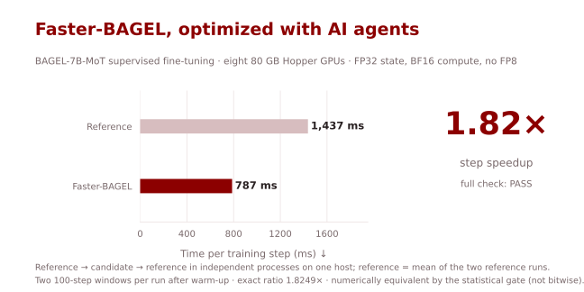
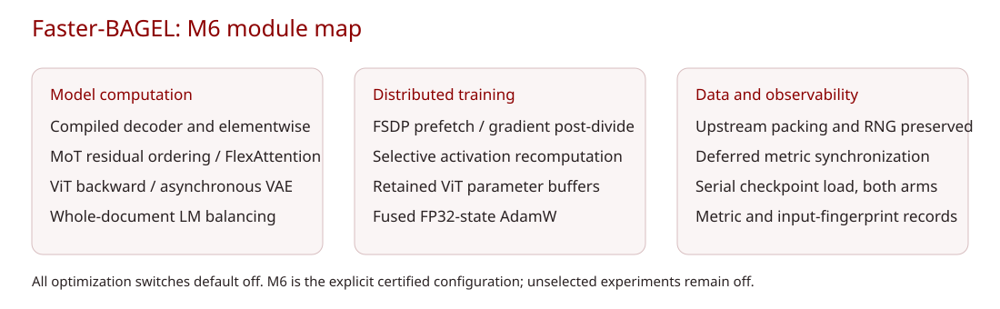
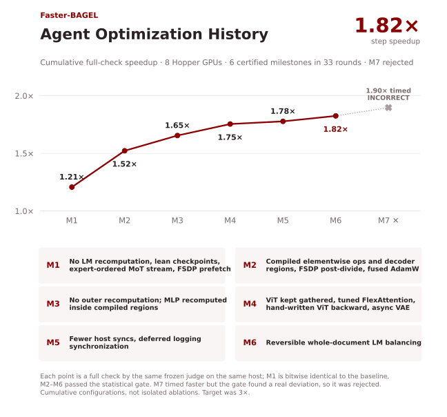
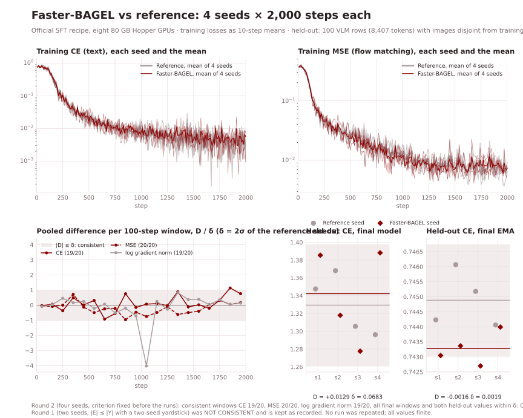
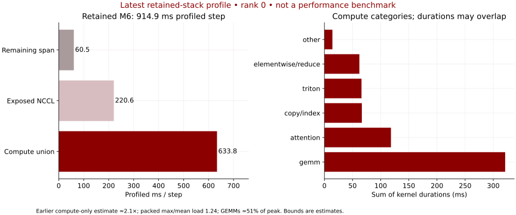

# Faster-BAGEL

[English](README.md) | [简体中文](README.zh-CN.md)

**1.8249× faster BAGEL-7B-MoT supervised fine-tuning steps on 8 × 80 GB Hopper GPUs, optimized with AI agents.**



| Implementation | Seconds / step ↓ | Speedup ↑ |
|---|---:|---:|
| Reference | 1.4367 | 1.0000× |
| **Faster-BAGEL (M6)** | **0.7873** | **1.8249×** |

Measured with the official checkpoint SFT recipe: 14.61B total parameters, FSDP HYBRID_SHARD 1×8, FP32 parameters, AdamW and EMA, BF16 compute. The full check runs reference → candidate → reference in independent processes with fresh compile caches, then checks numerical correctness. M6 passed at **N1 statistical equivalence**; it is not bitwise identical. The goal was 3× and was not reached.

## Quick Start

Prepare the [environment and public data](docs/training.md), including the 900/100 VLM split. Set absolute paths:

```bash
export MODEL_PATH=/path/to/BAGEL-7B-MoT
export BAGEL_DATA_ROOT=/path/to/bagel_example
export BAGEL_TRAIN_JSONL=/path/to/train.jsonl
export BAGEL_EDIT_META=/path/to/edit_meta.json
export OUTPUT_DIR=/path/to/results
export CHECKPOINT_DIR=/path/to/local/checkpoints
export CACHE_DIR=/path/to/local/fresh-cache
export GPU_LOCK=/path/to/shared-gpu.lock
bash scripts/train_faster_bagel_sft.sh
```

The launcher explicitly enables M6. With no `BAGEL_OPT_*` variable set, the code follows the upstream computation; the common serial checkpoint load and logging corrections remain. `REFERENCE=1` clears the switches. Tested with PyTorch 2.7.1+cu126, Triton 3.3.1 and flash-attn 2.7.4.post1. The portable launcher has been checked without launching another training run; see [validation reproduction](scripts/validate/README.md).

## What changed

- Selective activation recomputation and a permuted MoT residual stream reduce memory movement and repeated computation.
- Compiled elementwise and decoder regions, tuned FlexAttention, and fused AdamW reduce kernel and Python overhead.
- FSDP forward prefetch, post-division and retained ViT buffers improve communication scheduling.
- Explicit ViT backward, asynchronous VAE execution and deferred metric synchronization shorten the critical path.
- Reversible whole-document LM balancing redistributes packed documents and restores their original order.



The [switch table](docs/training.md#switches) maps these changes to files and measured milestones. Memory rises: the full check peaked at 60.05 GiB allocated / 73.36 GiB reserved per GPU, versus 41.16 / 57.89 GiB for the reference.

## Agent optimization history



M1–M6 passed full checks. M7 timed at 1.8972× but was **INCORRECT** and was rejected. These are cumulative configurations; milestone increments are not isolated switch ablations. See the [judge acceptance and control results](docs/judge.md).

## Validation

**Both rounds are retained.** Eight independent 2000-step runs used global seeds 4396–4399, four per implementation, with data_seed 42. Every final model and EMA was evaluated by the same reference implementation on 100 image-content-disjoint VLM rows (8407 supervised tokens), without dropout. All training and evaluation values were finite; no training run was repeated.

| Analysis | Training CE | Training MSE | Mean log gradient norm | Held-out model / EMA | Verdict |
|---|---:|---:|---:|---|---|
| Round 1, two seeds; consistent windows | 9/20 | 8/20 | 5/20 | both fail | **NOT CONSISTENT** |
| Round 2, four seeds; consistent windows | 19/20 | 20/20 | 19/20 | both pass | **CONSISTENT** |

Round 1 compares each same-seed difference and the candidate seed spread against the reference two-seed spread. Its final CE window fails. Round 2 was fixed before the new runs: δ = twice the reference sample SD across four seeds, D = mean(M6) − mean(reference); |D| ≤ δ. Each training metric permits at most two failed windows and requires its final window to pass. All final windows passed. Two-sided sign-test p values were 0.5034 (CE), 0.04139 (MSE), 0.2632 (log norm); none triggered the p<0.01 bias flag. Paired t-test p values are descriptive. The second result does not rewrite the first.

Pooled held-out model CE: reference 1.3293698, M6 1.3422934 (D=+0.0129236, δ=0.0683410). EMA CE: 0.74488545 vs 0.74327525 (D=−0.00161020, δ=0.00185845). This finite four-seed result is evidence under the specified criterion, not proof of identical training distributions.



Original results, sanitized only for identifying metadata: [round 1](docs/validation/verdict.md), [round 2](docs/validation/round2/verdict.md). All 16000 recorded steps and 1600 held-out row scores are included for [CPU recomputation](scripts/validate/README.md). Validation launch-to-exit times were 3517–3726 s for reference and 2110–2209 s for M6, including initialization and saves, on different machines. These are descriptive timings, not a paired benchmark speedup.

## Limits

The image-generation examples repeat one image; edit examples repeat one four-image chain. Their losses measure fitting a repeated fixture. Only the disjoint VLM held-out CE provides generalization evidence, and it does not establish generation quality. Gradient spikes above 10 occurred in both implementations and are reported per arm.

Earlier profiling estimated about **2.1×** with existing compute kernels even if waiting and imbalance disappeared: heaviest-rank/mean packed length 1.24, CPU-bound forward, and GEMMs around 51% of dense BF16 peak. The latest M6 profile still has 633.8 ms compute union and 220.6 ms exposed communication per step; profiling overhead differs from benchmark timing. These are implementation-specific estimates, not a universal lower bound. The 3× goal was not reached.



Upstream: [ByteDance-Seed/Bagel](https://github.com/ByteDance-Seed/Bagel), revision `a2fa77dd8caeefc41e6607ae0ec17408d3f4ee9f`. The `upstream` branch is its pristine tree. Original documentation is preserved verbatim in [README.upstream.md](README.upstream.md). [Apache-2.0](LICENSE).
